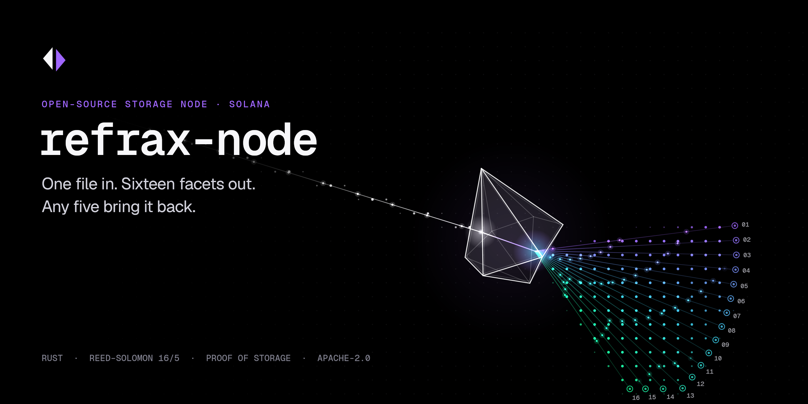

<p align="center">
  
</p>

<p align="center">
  <b>The open-source storage node for <a href="https://refrax.xyz">Refrax</a>, object storage coordinated on Solana.</b><br>
  Every object becomes 16 facets on 16 nodes. Any 5 rebuild it. Solana keeps the receipt, never the bytes.
</p>

<p align="center">
  <a href="https://github.com/refrax-xyz/refrax-node/actions/workflows/ci.yml"></a>
  <a href="https://github.com/refrax-xyz/refrax-node/releases"></a>
  <a href="LICENSE"></a>
  
  
  <a href="https://x.com/refrax_xyz"></a>
</p>

<p align="center">
  <a href="https://refrax.xyz">Website</a> ·
  <a href="docs/protocol.md">Protocol</a> ·
  <a href="docs/architecture.md">Architecture</a> ·
  <a href="docs/running-a-node.md">Run a node</a> ·
  <a href="docs/api.md">HTTP API</a> ·
  <a href="CONTRIBUTING.md">Contributing</a>
</p>

<br>

<p align="center">
  
</p>

## What this is

Refrax splits every object into **16 facets** with a Reed–Solomon code and seats each facet on a different
node of a 16-node committee. **Any 5 facets rebuild the object**, so 11 nodes can disappear and the file
still opens. The registry keeps the size, the merkle roots, who holds which facet and the committee's
signatures. The bytes stay on the nodes.

Nodes keep proving they still hold their facet. Committee members challenge each other for a random
1 KiB chunk chosen by a beacon nobody can predict; the answer has to hash up to the registered root.
A node that misses is voted out of its stake.

This repository contains everything that runs on a machine:

| Crate | What it is |
|---|---|
| [`refrax-core`](crates/refrax-core) | Reed–Solomon over GF(2⁸), SHA-256 merkle commitments, ed25519 identities, storage challenges. Pure, no I/O. |
| [`refrax-node`](crates/refrax-node) | The storage node, the registry, the client and the local devnet. |
| [`refrax-cli`](crates/refrax-cli) | The `refrax` binary: `devnet`, `node`, `put`, `get`, `audit`, `status`, `keys`, `inspect`. |

## Install

```sh
curl -fsSL https://raw.githubusercontent.com/refrax-xyz/refrax-node/main/install.sh | sh
```

The script picks the build for your OS and CPU from the [latest release](https://github.com/refrax-xyz/refrax-node/releases/latest),
checks its SHA-256 and puts `refrax` in `~/.local/bin`. Release builds: Linux x86_64 and arm64, macOS
Apple silicon and Intel, Windows x86_64.

Or with Docker: `docker pull ghcr.io/refrax-xyz/refrax-node`. Or from source, with [Rust](https://rustup.rs) stable:

```sh
cargo install --git https://github.com/refrax-xyz/refrax-node refrax-cli
```

## Quick start

```sh
refrax devnet up                          # a registry and 16 nodes on localhost
```

In a second terminal:

```sh
refrax put ./photo.jpg                    # encode → register → scatter → certify
refrax get <object-id> -o copy.jpg        # rebuilt from any 5 facets
refrax audit <object-id>                  # challenge all 16 holders once
refrax devnet wipe 7                      # delete node-07's data…
refrax status                             # …and see its stake slashed
```

`refrax inspect <file>` shows the 16 facets, their merkle roots and rebuilds the file from random sets of
five, without any network.

## How it works

```mermaid
sequenceDiagram
    autonumber
    participant C as Client
    participant R as Registry (Solana)
    participant N as 16 nodes
    C->>C: cut the file into 16 facets (any 5 rebuild it)
    C->>R: register manifest (size, 16 facet roots, object root)
    R-->>C: object id + committee seats
    C->>N: facet i → seat i, in parallel
    N->>N: check bytes against the registered facet root
    N-->>C: signed receipt per facet
    C->>R: certificate (≥ 11 receipts)
    R-->>C: certified
    loop every few hundred slots
        N->>N: challenge peers for a random 1 KiB chunk
        N->>R: 2 misses in a row → vote; 11 votes → slash
    end
```

| Parameter | Value | Where |
|---|---|---|
| Facets per object | 16 | `refrax_core::FACETS` |
| Facets to rebuild | 5 (any 5; 11 can be lost) | `refrax_core::REBUILD` |
| Code | systematic Reed–Solomon, Cauchy matrix over GF(2⁸) | [`erasure.rs`](crates/refrax-core/src/erasure.rs) |
| Storage overhead | 3.2× | 16 / 5 |
| Merkle leaf | 1 KiB, SHA-256, domain-separated leaves and nodes | [`merkle.rs`](crates/refrax-core/src/merkle.rs) |
| Certificate | 11 of 16 committee signatures (⌈⅔⌉) | `refrax_core::QUORUM` |
| Slash | 11 votes, 500 REFRAX, once per object, facet and epoch | [`registry.rs`](crates/refrax-node/src/registry.rs) |
| Identities | ed25519, base58, `solana-keygen` JSON format | [`identity.rs`](crates/refrax-core/src/identity.rs) |
| Slot | 400 ms; devnet epoch 432 slots | [`registry.rs`](crates/refrax-node/src/registry.rs) |

The full specification, with every hash input and domain tag, is in [docs/protocol.md](docs/protocol.md).

## Run a node

```sh
refrax keys new                                   # ~/.config/refrax/node.json, solana-keygen format
refrax node start \
  --registry https://registry.example \
  --listen 0.0.0.0:7701 \
  --public-url https://node.example.com \
  --data-dir /var/lib/refrax \
  --stake 2500
```

Or with Docker:

```sh
docker run -d --name refrax -p 7701:7701 -v refrax-data:/data \
  -e REFRAX_REGISTRY=https://registry.example \
  -e REFRAX_PUBLIC_URL=https://node.example.com \
  ghcr.io/refrax-xyz/refrax-node
```

Hardware, TLS, systemd, metrics and operations: [docs/running-a-node.md](docs/running-a-node.md).
Prometheus metrics are served at `/metrics`.

## Use the core as a library

```rust
use refrax_core::erasure::{decode_object, encode_object};
use refrax_core::Manifest;

let encoded = encode_object(&bytes);              // 16 facets
let manifest = Manifest::from_encoded(&encoded);  // what gets registered
println!("object {}", manifest.id());

// keep only facets 11..16 — all parity, none of the original bytes
let five: Vec<(usize, &[u8])> = (11..16).map(|i| (i, encoded.facets[i].as_slice())).collect();
assert_eq!(decode_object(&five, encoded.size, encoded.shard_len)?, bytes);
```

Run it: `cargo run -p refrax-core --example roundtrip -- <file>`.

## Status

This is a **devnet preview**. It is not audited. Do not store anything you cannot lose.

| State | Component |
|---|---|
| **shipped** | Erasure coding, merkle commitments, manifests and object ids |
| **shipped** | Storage node: seat checks, root checks, signed receipts, facet store |
| **shipped** | Proof of storage: beacon-derived challenges, peer audits, slashing votes |
| **shipped** | Local registry mirroring the on-chain accounts, devnet in one command |
| **shipped** | CLI, Docker image, Prometheus metrics, tests and CI |
| next | `refrax_registry` and `refrax_staking` programs on Solana devnet (the registry backend swaps, the HTTP shape stays) |
| next | REFRAX stake bonded on chain; storage fees paid per epoch |
| next | Committee rotation and self-repair from any 5 facets |
| next | Public explorer |

## Repository layout

```
crates/
  refrax-core/     coding, merkle, ids, keys, challenges  (no I/O)
  refrax-node/     node, registry, client, devnet         (+ tests/devnet.rs: 16 nodes over HTTP)
  refrax-cli/      the `refrax` binary
docs/              protocol, architecture, running a node, HTTP API
deploy/            docker compose devnet, systemd unit
scripts/           demo.svg generator
install.sh         release installer (checks SHA-256)
```

## Development

```sh
cargo test --workspace          # unit tests + a 16-node devnet over real HTTP
cargo clippy --all-targets -- -D warnings
cargo fmt --all
```

`make help` lists the shortcuts. The tests rebuild every one of the C(16,5) = 4,368 five-facet subsets,
take 11 nodes offline including all data facets, and wipe a node until the committee slashes it.

## Contributing

Issues and pull requests are welcome. Read [CONTRIBUTING.md](CONTRIBUTING.md) first. Security reports go
to the process in [SECURITY.md](SECURITY.md), not to public issues.

## License

[Apache-2.0](LICENSE). Not affiliated with the Solana Foundation.
