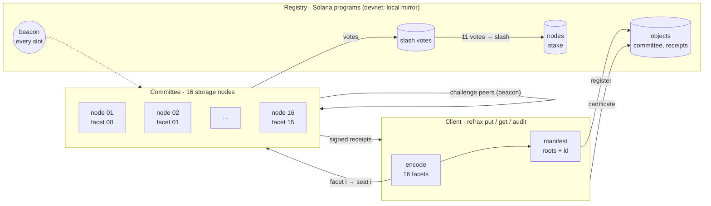
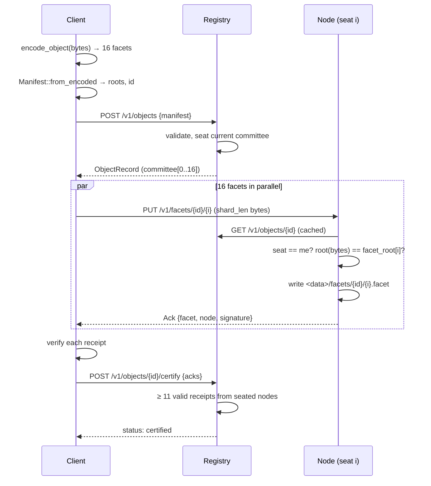
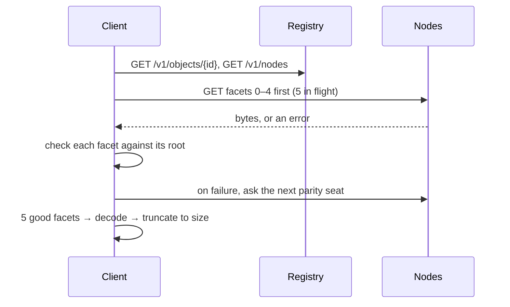
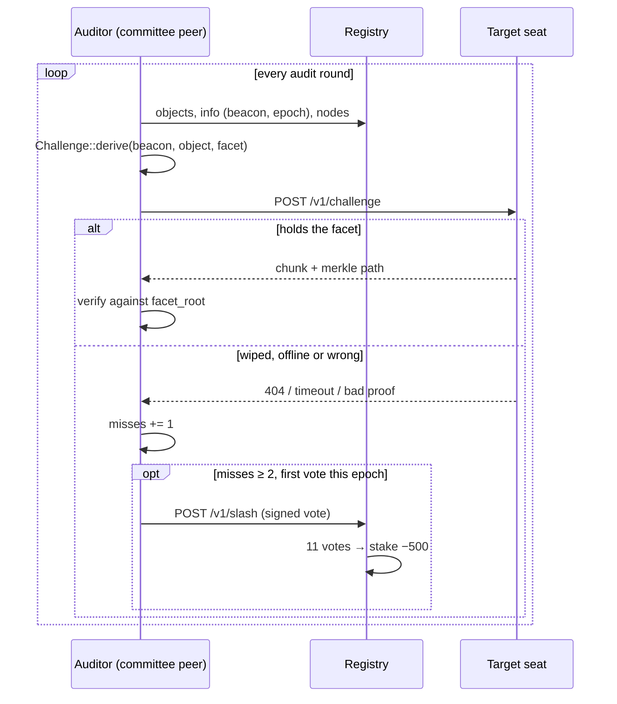

# Architecture

## Crates

| Crate | Depends on | Does |
|---|---|---|
| `refrax-core` | sha2, ed25519-dalek, bs58, serde | The math: GF(2⁸), Reed–Solomon, merkle, manifests, ids, keys, challenges. No I/O, no async. |
| `refrax-node` | core, tokio, axum, reqwest | Node server, auditor, facet store, registry (server + client), client operations, devnet. |
| `refrax-cli` | core, node, clap | The `refrax` binary and its terminal output. |

The core is kept free of I/O so the same code can run in a node, a client, a browser (WASM) or an on-chain
verifier.

## Store

## Read

## Audit and slash

## The devnet

`refrax devnet up` starts, in one process:

* a registry on `:7700` with a 400 ms slot clock and the beacon,
* 16 nodes on `:7701–7716`, each with its own key in `.refrax/devnet/node-NN/keypair.json`,
  data directory and auditor (`--allow-wipe` on, so `refrax devnet wipe N` works).

Keys persist between runs; facets and registry state start fresh each time, like
`solana-test-validator --reset`.

## What changes on mainnet

Only the registry backend. Nodes and clients talk to the HTTP API in [api.md](api.md); on mainnet that API
is served by an indexer in front of the `refrax_registry` and `refrax_staking` programs, writes become
Solana transactions signed by the same ed25519 keys, and the beacon becomes a recent slot hash.
